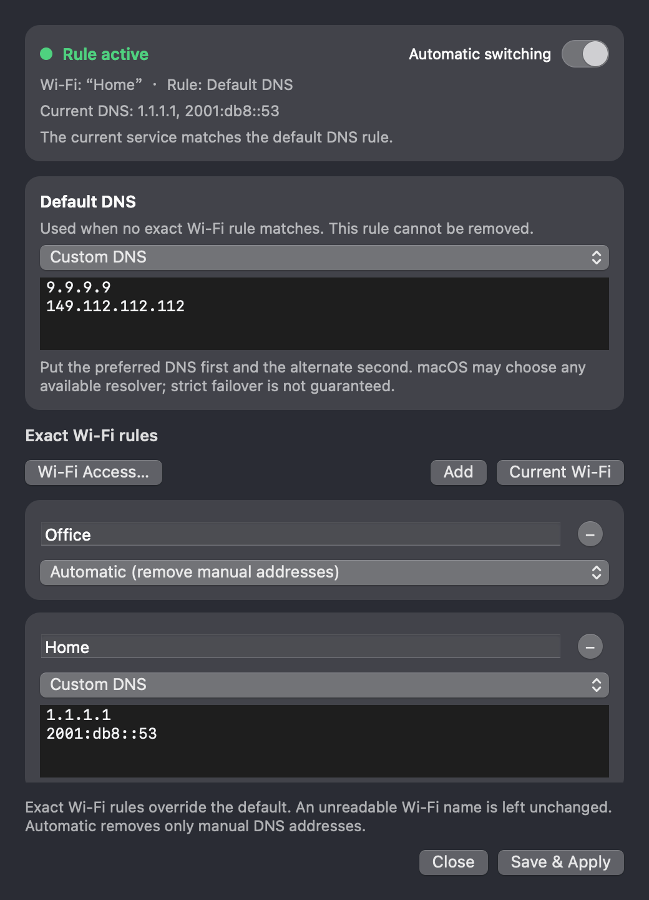

<p align="center"></p>
<h1 align="center">ftop · personal enhanced edition</h1>
<p align="center">
  A native floating monitor for Apple Silicon Macs,<br>
  enhanced with per-Wi-Fi DNS switching and per-process network rankings.
</p>
<p align="center"><a href="README.zh-CN.md">中文说明</a></p>

<p align="center"></p>

This is my personal fork of ftop. It keeps the quiet, adaptive macOS monitor and
focuses on two additions I use every day:

- choose system DNS automatically for each Wi-Fi;
- rank applications by current download and upload activity.

## Main addition: Wi-Fi DNS rules

ftop can read the current system DNS and apply a verified DNS setting when Wi-Fi
changes.

- Add exact, case-sensitive rules for individual Wi-Fi names.
- A separate **Default DNS** rule always exists and cannot be deleted. Exact rules
  win; every other identifiable Wi-Fi uses the default.
- Each rule can use **Automatic** (remove manual `ServerAddresses`) or a validated
  list of custom IPv4/IPv6 addresses.
- For two custom resolvers, enter the preferred DNS first and the alternate second.
  macOS may still choose any available resolver, so strict failover is not promised.
- Changes run only after Save and on Wi-Fi/link/wake events. There is no polling or
  continuous overwrite loop.
- Native authorization, service identity checks, conflict detection, commit/apply
  and read-back verification protect every write.
- Location permission is used only to read the connected Wi-Fi name. If the name
  or physical service cannot be verified, DNS is left unchanged.
- ftop does not inspect or modify Clash, Mihomo, TUN or other proxy configuration.

<p align="center"></p>

The panel also shows the current DNS and source. Hover **More → Wi-Fi DNS rules**
for the full read-only snapshot, or run:

```bash
ftop dns --json
```

## Process network rankings

The process list can rank apps by CPU, memory, download or upload. Network rows use
the native TCP/UDP socket activity reported by macOS and show **Reading data…** until
the first samples arrive. Switching away keeps collection alive for 20 seconds so a
quick return can reuse it; hiding the panel or disabling Processes stops it.

Proxy and TUN traffic may appear under both the original app and the proxy. These
rankings are application activity, not physical-interface totals.

## Monitor

The floating panel still adapts from a tiny strip to a detailed process view without
clipping or empty space. It shows current state only:

- per-core usage and frequency;
- memory, compression, swap and pressure;
- total network download/upload;
- GPU usage, frequency, memory and power;
- system power and available temperature sensors;
- grouped application processes with native icons;
- current system DNS.

Unavailable hardware readings remain unavailable instead of being displayed as zero.


## Build and install

Requirements: Apple Silicon and macOS 15 or later, with Xcode command-line tools.
This personal repository currently documents source builds rather than publishing
an official release package.

```bash
git clone git@github.com:PhySicalDogToo/ftop.git
cd ftop
scripts/check.sh
scripts/bundle.sh
scripts/install.sh
```

This installs `Ftop.app` into `~/Applications` and links the `ftop` command into
`~/.local/bin`.

## Use

```bash
ftop                    # open the panel
ftop toggle             # hide or show it
ftop quit               # close it
ftop doctor             # inspect sensor availability
ftop doctor --network   # inspect process-network collection
```

- Drag an edge to change layout; right-click for settings.
- Use **More → Process ranking** for CPU, memory, download or upload.
- Use **More → Wi-Fi DNS rules** to configure the default and exact rules.
- `sudo ftop grant` optionally enables system-process visibility through the small,
  argument-free helper included in the source tree.

## Validation and scope

The current build is `0.2.6 (16)`. `scripts/check.sh` passes strict formatting, a
warning-free production build and two complete 228-test runs. DNS writes in tests use
fake backends; the validation record and UI references live in
[`docs/evidence/2026-10-29-default-dns-rule/`](docs/evidence/2026-10-29-default-dns-rule/).

ftop supports English and Chinese. It intentionally has no history graphs or disk
panel. Private macOS sensor APIs can change with a system update; missing values are
reported honestly.

## Origin and license

This personal enhanced edition is based on
[Nongfsq/ftop](https://github.com/Nongfsq/ftop). It retains substantial upstream
ftop code, including the core monitoring, adaptive floating-panel layout, and sensor
implementations, while adding per-Wi-Fi DNS switching, a non-removable default DNS
rule, and per-process network rankings. The upstream ftop project began as a btop
fork but was later independently rewritten and shares no btop code. Licensed under
[MIT](LICENSE).
