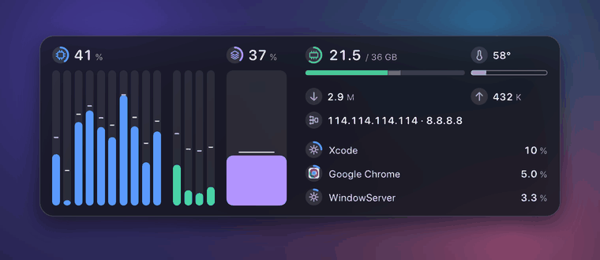
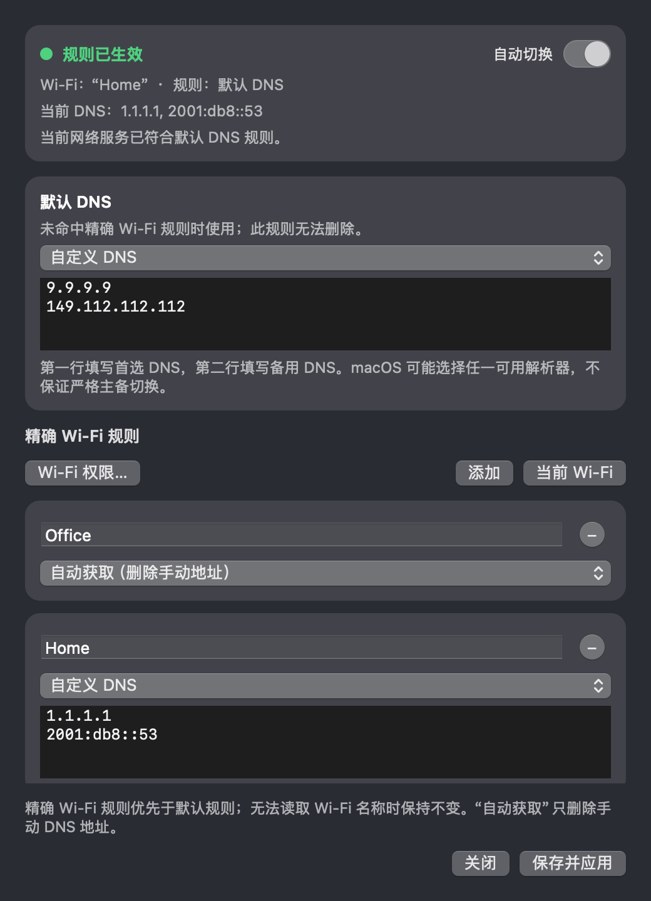
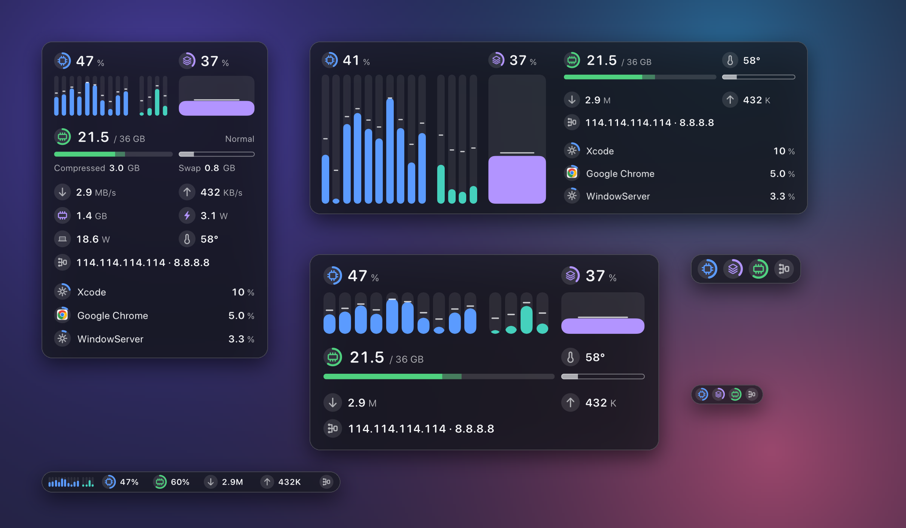

<p align="center"></p>
<h1 align="center">ftop · 个人增强版</h1>
<p align="center">
  一个给 Apple Silicon Mac 使用的原生浮动监视器，<br>
  新增按 Wi-Fi 自动切换 DNS 和进程上传／下载排行。
</p>
<p align="center"><a href="README.md">English</a></p>

<p align="center"></p>

这是我的 ftop 个人分支。它保留了安静、自适应的 macOS 监视面板，
重点加入了两项日常使用的功能：

- 根据当前 Wi-Fi 自动选择系统 DNS；
- 按当前下载和上传活动排列应用。

## 重点新功能：Wi-Fi DNS 规则

ftop 可以读取当前系统 DNS，并在 Wi-Fi 变化时应用经过验证的 DNS 设置。

- 可为具体 Wi-Fi 名称添加大小写和空格都精确匹配的规则。
- **默认 DNS** 是一条独立且无法删除的规则。精确规则优先，其他可识别 Wi-Fi
  全部使用默认规则。
- 每条规则可选 **自动获取**（删除手动 `ServerAddresses`）或自定义 IPv4／IPv6。
- 填写两个自定义 DNS 时，第一行为首选，第二行为备用。macOS 仍可能选择
  任一可用解析器，因此不保证严格主备切换。
- 只在保存时以及 Wi-Fi、链路、唤醒事件发生时处理，不轮询，不持续覆盖 DNS。
- 每次写入都保留原生授权、网络服务识别、冲突检查、提交／应用和写后验证。
- 定位权限只用于读取当前 Wi-Fi 名称。名称或物理网络服务无法确认时不修改 DNS。
- ftop 不检测或修改 Clash、Mihomo、TUN 以及其他代理软件配置。

<p align="center"></p>

浮窗也会显示当前 DNS 和来源。鼠标悬停在 **更多 → Wi-Fi DNS 规则** 可查看完整的
只读快照，也可以运行：

```bash
ftop dns --json
```

## 进程网络排行

进程列表可按 CPU、内存、下载或上传排序。网络排行使用 macOS 报告的原生 TCP／UDP
套接字活动，首次采样期间显示**“数据读取中”**。切到其他排行后保留采集 20 秒，
方便快速切回；隐藏浮窗或关闭进程模块时停止采集。

代理和 TUN 流量可能同时出现在原应用和代理进程下。这是应用活动排行，不是物理网卡总流量。

## 系统监视

浮动面板仍可从极窄长条自适应到完整进程视图，不裁切内容，不留无用空白。
它只显示当前状态：

- 每核占用和频率；
- 内存、压缩、交换和压力；
- 总下载和上传速率；
- GPU 占用、频率、显存和功耗；
- 整机功耗和可用温度传感器；
- 带原生图标、合并帮助进程的应用列表；
- 当前系统 DNS。

硬件没有提供的读数会显示为“不可用”，不会冒充为 0。



## 构建和安装

要求：Apple Silicon、macOS 15 或更高版本，并安装 Xcode 命令行工具。
这个人仓库目前以源码构建为主，不作为上游官方发布页。

```bash
git clone git@github.com:PhySicalDogToo/ftop.git
cd ftop
scripts/check.sh
scripts/bundle.sh
scripts/install.sh
```

这会把 `Ftop.app` 安装到 `~/Applications`，并把 `ftop` 命令链接到 `~/.local/bin`。

## 使用

```bash
ftop                    # 打开面板
ftop toggle             # 隐藏或显示
ftop quit               # 退出
ftop doctor             # 检查传感器可用性
ftop doctor --network   # 检查进程网络采集
```

- 拖动边缘切换布局，右键打开设置。
- 在 **更多 → 进程排序** 中选择 CPU、内存、下载或上传。
- 在 **更多 → Wi-Fi DNS 规则** 中配置默认和精确规则。
- `sudo ftop grant` 可选地允许显示系统进程；它只使用源码中那个不接受参数的小型辅助程序。

## 验证和边界

当前构建为 `0.2.6 (16)`。`scripts/check.sh` 已通过严格格式检查、无警告构建以及两轮完整的
228 项测试。DNS 写入测试全部使用模拟后端；验证记录和界面参考图位于
[`docs/evidence/2026-10-29-default-dns-rule/`](docs/evidence/2026-10-29-default-dns-rule/)。

ftop 支持中文和英文，故意不加入历史曲线和磁盘面板。macOS 私有传感器接口可能随系统
版本变化，缺失读数会如实标记。

## 来源和许可证

本项目是基于 [Nongfsq/ftop](https://github.com/Nongfsq/ftop) 开发的个人增强版本，
保留了上游 ftop 的核心监控、浮窗布局和传感器实现，并新增 Wi‑Fi DNS 自动切换、
不可删除的默认 DNS 规则及进程网络排行等功能。上游 ftop 最初由 btop 派生，后来已独立重写，
当前不共享 btop 代码。项目采用 [MIT](LICENSE) 许可证。
